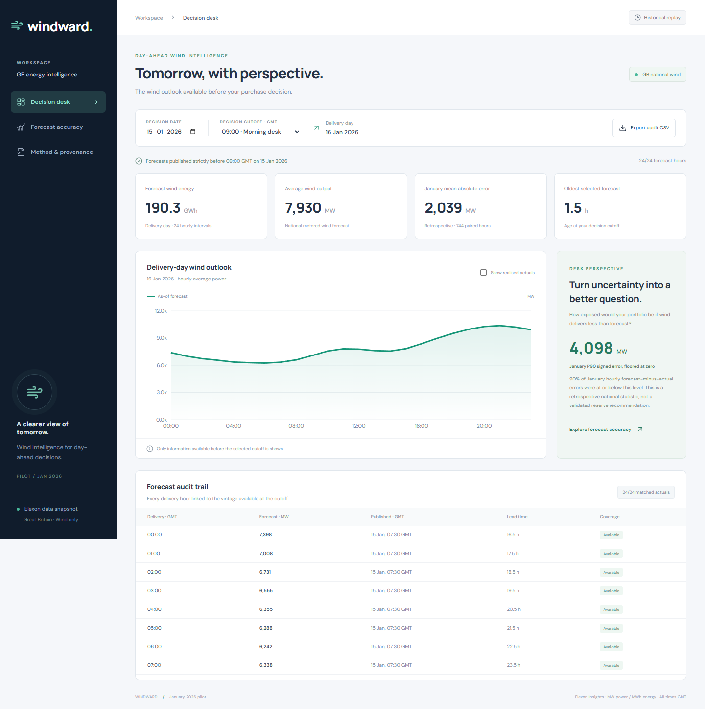

# Windward — day-ahead wind intelligence

A React + Python pilot for a GB electricity procurement desk. Replay the wind forecast available at a January 2026 decision cutoff, inspect its publication vintage, and evaluate it against Elexon actuals without selecting later forecasts.

**Live application:** https://q7m2x9va.vercel.app

**Public repository:** https://github.com/vidyaaaas/q7m2x9va

**Unlisted video demo:** https://youtu.be/n-ZiWoceHgw (7:54; client overview 00:00–03:31, technical overview 03:31–end).

**Verification:** public application and browser/API checks passed; [GitHub CI](https://github.com/vidyaaaas/q7m2x9va/actions/runs/40279053311) passed Python tests, data validation, frontend build, Docker build and container health check.

## Start with Docker

Prerequisite: Docker Engine / Docker Desktop with Compose.

```sh
docker compose up --build
```

Open http://localhost:8000. API docs: http://localhost:8000/docs. The snapshot is bundled; no API keys or network access are required at runtime. The multi-stage image builds React, runs FastAPI as a non-root user, and honours `PORT`. Docker is not installed in the authoring environment. The [public GitHub CI run](https://github.com/vidyaaaas/q7m2x9va/actions/runs/40279053311) passed the Docker image build and container health smoke test, as well as Python tests, snapshot validation and the frontend build.

## Start without Docker

Use Python 3.13 and Node.js 22 or newer. Run from this directory:

```sh
python -m venv .venv
# Windows PowerShell: .venv\Scripts\Activate.ps1
# macOS/Linux: source .venv/bin/activate
pip install -r requirements-dev.txt
npm ci --prefix frontend
npm run build --prefix frontend
python -m uvicorn backend.main:app --host 127.0.0.1 --port 8000
```

For frontend development, run `npm run dev --prefix frontend` in another terminal. Vite proxies `/api` to port 8000. Production serves the compiled UI and API from the same origin.

## Product walkthrough

1. **Decision desk:** choose a decision date and cutoff; see next-day wind energy, hourly forecasts, vintage age, and an exportable audit trail.
2. Enable **Show realised actuals** to compare outturn. It is off by default to distinguish hindsight from decision-time information.
3. **Forecast accuracy:** MAE, RMSE, bias, WAPE, coverage, daily scores and delivery-hour bias. Click a day to investigate it.
4. **Method & provenance:** definitions, scope limits, raw source URLs and SHA-256 file hashes.



## What the data actually says

The retrieved snapshot contains 18,688 WINDFOR records and 1,488 FUELHH WIND records. All 744 hourly delivery intervals match at all four UI cutoff presets.

| Decision cutoff (GMT) | MAE (MW) | RMSE (MW) | Bias (MW) | WAPE |
|---|---:|---:|---:|---:|
| 09:00 / 09:20 | 2,038.9 | 2,504.8 | +1,747.9 | 18.07% |
| 15:00 / 15:30 | 1,904.0 | 2,361.1 | +1,692.5 | 16.87% |

The afternoon MAE is 6.6% lower for this sample. Positive bias means forecasts exceeded observed generation on average. This is a measured difference between the specified series, not proof of a causal modelling defect, a forecast of future error, or a recommended purchase volume. Investigate series scope, metering, curtailment and revisions before interpreting persistent bias operationally; none of those explanations is established by this two-dataset pilot.

## Method and assumptions

- **Decision window:** 1–31 January 2026, inclusive; deliveries 2 January–1 February. The brief refers to purchase decisions in January, not delivery dates in January.
- **Timezone:** timezone-aware UTC timestamps; all relevant London dates are GMT. No DST transition occurs in this pilot. Extending beyond January requires explicit Europe/London settlement-day handling.
- **Cutoff:** latest `publishTime < cutoff`, independently for each target hour. Equality is deliberately excluded to avoid assuming data can be acted on at the deadline. Default 09:00 is a desk assumption, leaving 20 minutes before the documented GB 09:20 hourly auction. 15:00 is an afternoon comparison. No trading is executed.
- **Availability proxy:** `publishTime` is used because actual arrival timestamps are unavailable. Publication-before-cutoff is not proof that the client received the forecast before cutoff.
- **Resolution:** every downloaded January forecast target is on the hour. Actuals are half-hourly. Compare the forecast with the arithmetic mean of the two same-hour FUELHH values. This treats WINDFOR as hourly average power; no invented half-hour forecast values or interpolation.
- **Missing data:** require both actual halves. Exclude incomplete pairs from metrics, report coverage, and suppress a full-day energy total if any forecast hour is missing. Zero is a valid value, not a missing marker.
- **Duplicates:** exact download duplicates are removed. Latest publication wins; equal-publication conflicting generation values fail rather than silently choosing one.
- **Units:** power is MW; energy is MW × hours. Full delivery-day forecast energy is the sum of 24 hourly MW values in MWh; the UI divides by 1,000 for GWh.
- **Metrics:** error = forecast − actual; MAE = mean absolute error; RMSE = square root of mean squared error; bias = mean signed error; WAPE = sum absolute error / sum actual × 100. WAPE is undefined when its denominator is zero. P90 uses linear interpolation between ordered observations.
- **Hindsight:** the full-month metrics and empirical P90 are explicitly retrospective, including when visible alongside a replay. They are not inputs known at the decision cutoff and are not a calibrated uncertainty band. No claims of achieved savings or optimal reserve sizing are made.
- **Scope:** Elexon’s GB operationally metered wind series, not all UK renewables, embedded generation or a customer portfolio. With no demand, hedges or other generation inputs, the client’s required purchases cannot be derived. This pilot answers forecast visibility and error evaluation only.

## Repository map

| Path | Purpose |
|---|---|
| `frontend/src/main.jsx` | React views, charts, filters, audit table, loading/error states |
| `frontend/src/style.css` | Responsive visual design and keyboard focus states |
| `frontend/vite.config.js` | Local API proxy and production chunk splitting |
| `backend/analysis.py` | Pure cutoff selection, hourly alignment and metric functions |
| `backend/main.py` | FastAPI endpoints, bounded process caches, CSV, static UI hosting |
| `api/index.py` | Vercel ASGI adapter |
| `data/forecasts.json` | Real WINDFOR vintages, including preceding-day fallback publications |
| `data/actuals.json` | Real FUELHH WIND half-hour actuals |
| `data/manifest.json` | Retrieval timestamp, request URLs, row counts and hashes |
| `scripts/ingest.py` | Retry-aware public-data download; atomic replacement of each data file |
| `scripts/validate_snapshot.py` | Hashes, source resolution, coverage, cutoff invariants |
| `tests/` | Analysis edge-case and API integration tests |
| `docs/` | Screenshots, technical handover, demo script and validation results |
| `Dockerfile`, `compose.yaml` | Container build and local run |
| `vercel.json`, `heroku.yml` | Hosting configurations (Vercel verified) |
| `.github/workflows/ci.yml` | Automated tests, snapshot validation, frontend and Docker builds |

## Reproduce and test

```sh
python -m unittest discover -s tests -v
python scripts/validate_snapshot.py
npm run build --prefix frontend
npm audit --prefix frontend
```

To refresh data: `python scripts/ingest.py`, then validate and restart the API. Requests are daily, bounded, retry with backoff, and filter FUELHH to WIND. Runtime requests never contact Elexon. Re-ingestion can change revised actuals and hashes; preserve the original snapshot for exact reproducibility. File replacements are atomic individually, not transactionally across the entire snapshot; run refresh offline, then validate before deployment.

The 13 Python tests pass. Snapshot validation confirms 744/744 pairs at each UI cutoff. Frontend production build passes. At the time checked, npm audit reports zero known vulnerabilities. Browser checks cover navigation, cutoff recalculation, actual toggle, month boundary, CSV, mobile overflow and JavaScript errors. See `docs/TECHNICAL.md` for review details and verification limits.

## Publish

**Public repository:** https://github.com/vidyaaaas/q7m2x9va. Clone with `git clone https://github.com/vidyaaaas/q7m2x9va.git`. The repository name is anonymous; the GitHub account and commit identity are not thereby anonymised.

**Vercel:** import the repository with its root at this directory; use the included `vercel.json`. It builds the React frontend and a Python function, bundling the snapshot. The production deployment at https://q7m2x9va.vercel.app passed checks for `/`, `/api/health`, `/api/day`, `/api/month`, `/api/provenance`, `/api/export` and `/docs`, plus desktop/mobile browser interactions. Deployment ID: `dpl_4FjDzp3fpzvNJneTpyJ9JxGhkQRZ`; application commit: `538d96d`. The deployed snapshot is gzip-compressed without changing its decoded JSON values.

**Heroku alternative:** create an app, set its stack to `container`, and deploy this repository with `heroku.yml`. `PORT` is provided by Heroku. Use this route if a Docker-based hosted deployment is preferred. Hosting may require an account plan; no paid resources have been provisioned.

**Video:** https://youtu.be/n-ZiWoceHgw — uploaded as **Unlisted**, with synthetic narration disclosed. Total duration is 7:54; both overview sections are under five minutes. The transcript and chapters are in `docs/`.

## AI assistance

This application was developed with OpenAI Codex AI assistance for research, implementation, test creation, visual review, documentation and demo preparation. AI-generated code was exercised with automated tests and browser checks. Synthetic narration, where included in the demo, is disclosed; no generated data is presented as Elexon data.

## Sources

- [Elexon FUELHH stream documentation](https://bmrs.elexon.co.uk/api-documentation/endpoint/datasets/FUELHH/stream)
- [Elexon WINDFOR stream documentation](https://bmrs.elexon.co.uk/api-documentation/endpoint/datasets/WINDFOR/stream)
- [Elexon wind forecast scope](https://bmrs.elexon.co.uk/api-documentation/endpoint/forecast/generation/wind/latest)
- [EPEX trading brochure: GB auction times](https://www.epexspot.com/sites/default/files/2024-09/Trading%20Brochure%202024%20August.pdf)
- [Vercel Python runtime documentation](https://vercel.com/docs/functions/runtimes/python)

The public source endpoints and raw response fields remain the authoritative lineage. The older EPEX brochure supports the timing assumption; the client must confirm its actual venue, decision cutoff and operational lead time before live use.
