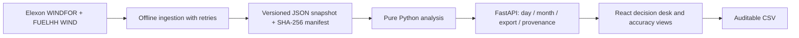

# Technical review and knowledge transfer

## Architecture

The small, fixed pilot dataset does not require a database. Immutable JSON keeps review and deployment simple. No credentials, customer data or external data dependencies are required at runtime. A single process loads the snapshot once; monthly results use an LRU cache capped at 64 cutoff keys. The date and cutoff query parameters are validated by FastAPI. There are no mutation endpoints.

## Read the code in this order

1. `backend/analysis.py`: `build_report` filters by delivery date and publication cutoff, selects the latest vintage, aligns actuals, then builds 24 rows. `metrics` computes only matched pairs.
2. `tests/test_analysis.py`: proof of the consequential edge cases—equal-cutoff exclusion, missing halves, zero denominators, duplicate conflicts, sign and February delivery.
3. `scripts/ingest.py` and `data/manifest.json`: review raw provenance and daily requests. WINDFOR request boundaries can overlap; exact rows are deduplicated.
4. `backend/main.py`: validated API, CSV response, cache boundary, static frontend.
5. `frontend/src/main.jsx`: three views and explicit retrospective labels. AbortController cancels superseded requests, preventing stale responses from overwriting newer filters.
6. Docker and CI: separate frontend build stage, non-root runtime, bounded dependencies, tests and health probe.

## API contract

| GET endpoint | Inputs | Result |
|---|---|---|
| `/api/day` | `date=2026-01-15&cutoff=09:00` | 24 hourly rows, selected vintage, actual mean, errors, age, coverage |
| `/api/month` | `cutoff=09:00` | Aggregate, daily and delivery-hour scores |
| `/api/export` | Same as day | CSV including cutoff, target and publication timestamp |
| `/api/provenance` | None | Source request URLs, retrieved time and file hashes |
| `/api/health` | None | Snapshot load status and record counts |
| `/docs` | None | Generated OpenAPI UI |

Missing data returns JSON null. No float NaN or infinity is emitted. Invalid date/time values return 422. A missing snapshot returns 503 with an actionable instruction. Conflicting equal-publication values cause analysis failure; malformed unexpected source schemas remain a limitation of the small offline importer.

## Validation evidence

- 13 unit/API tests passed locally.
- 18,688 forecast rows: all targets on hourly boundaries.
- 1,488 WIND actual rows: two half-hours for every evaluated hour.
- 744 matched pairs at 09:00, 09:20, 15:00, 15:30; all selected publication times strictly precede cutoff.
- SHA-256 checks match manifest.
- Frontend production compilation passed; npm dependency audit cleared after updating Vite to 6.4.5.
- Browser screenshots and checks are generated against the actual local API, not static mock data.
- Vercel production deployment is READY at https://q7m2x9va.vercel.app. Public browser checks pass; all seven tested HTTP endpoints return 200 and the monthly metrics match local validation. GitHub CI run 40279053311 passed Python tests, snapshot validation, frontend build, Docker image build and container health smoke test. Docker was verified in CI rather than on the authoring computer.

## Tradeoffs and next production steps

Selection is linear over the snapshot for each day; this is acceptable for 31 days and cached monthly responses. For a longer history, index by target and publication time or use SQL with a composite index. Keep the selection function as a tested reference implementation.

For production, add a scheduled ingestion service, transactional snapshot promotion, schema validation, source freshness alarms and observed ingestion timestamps. Model the client's auction explicitly. Expand history before estimating uncertainty, use rolling-origin evaluation, report calibration and distinguish forecast changes from revisions in actuals. A decision-time risk model must train only on actuals available before each cutoff; the existing full-month P90 is intentionally not that model.

Portfolio integration needs customer demand, contracted generation, hedges and risk policy. Those inputs were excluded by the brief, so the UI does not invent a thermal procurement recommendation. Live access controls and desk entitlements would be needed for those private inputs.

The pilot time budget prioritises data semantics, a useful interface, tests, reproducibility and clear handover. It deliberately avoids authentication, databases, trading integration and an unvalidated predictive model.
